# Evidence Run and Recovery Test

Generated by `python scripts/evidence_run.py` on 2026-10-18 22:25 (local time), running the real
supervisor, collector and Flask dashboard with a fast demo replay (120x: one reading every 0.5 s,
Module 6 sample 200 onward). Stale after 1.5 s, FAILED after 7.5 s at this speed.

## Checks
| Result | Check | Detail |
|---|---|---|
| PASS | dashboard running, HEALTHY, current reading shown | 23.68 C at 2026-10-18T22:22:36.079 |
| PASS | threshold alert activated | median 24.02 C |
| PASS | stale data detected and shown | data stale: last reading 2.4 s ago (stale after 1.5 s) |
| PASS | missing data -> FAILED | expected data stopped arriving: no reading for 8.4 s (expected every 0.5 s) |
| PASS | data resumed -> RECOVERING (shown on the page) |  |
| PASS | back to HEALTHY after data gap |  |
| PASS | threshold alert cleared (hysteresis) | median 23.56 C |
| PASS | dashboard available again | after 1.6 s |
| PASS | health returned to HEALTHY | after 3.0 s |
| PASS | both processes have new PIDs | worker 1339 -> 1423, web 1340 -> 1424 |
| PASS | SQLite live history continues (numbering not reset) | sample 317 -> 322 |
| PASS | Module 6 history still usable after recovery | last-day window: 1,420 of 1,440 readings |
| PASS | children exit when the supervisor dies (no orphans) | after 2.4 s |
| PASS | system HEALTHY after supervisor restart | after 4.3 s |
| PASS | log contains normal startup | 'SUPERVISOR_START' |
| PASS | log contains successful readings | 'READING sample=' |
| PASS | log contains alert activation | 'ALERT_ACTIVE' |
| PASS | log contains alert clearing | 'ALERT_CLEARED' |
| PASS | log contains stale data | 'DATA_STALE' |
| PASS | log contains missing data | 'DATA_MISSING' |
| PASS | log contains application error (process killed) | 'CHILD_EXIT' |
| PASS | log contains restart | 'CHILD_RESTART' |
| PASS | log contains recovery in collector log | 'RECOVERY previous collector run ended unexpectedly' |
| PASS | log contains recovery in supervisor log | 'RECOVERY previous supervisor run did not stop cleanly' |
| PASS | log contains clean shutdown | 'SUPERVISOR_STOP' |

## Recovery test A - collector and dashboard killed (kill -9)
- Killed: collector pid 1339, dashboard pid 1340
- Dashboard answering again after **1.6 s**; health back to HEALTHY after **3.0 s**
- New pids: collector 1423, dashboard 1424
- Readings that fell due while the collector was down were not backfilled: see `DATA_LOST` in `logs/worker.log`.

## Recovery test B - supervisor killed (kill -9)
The children noticed the supervisor was gone and exited (orphan guard). The supervisor was then started
again by this script - the step the operating system performs in a real install (systemd `Restart=always`,
launchd `KeepAlive`, Windows Task Scheduler 1-minute trigger). It logged `RECOVERY`, and the system
returned to HEALTHY.

## Run log
```
22:22:33.829  supervisor started (pid 1330); demo replay 120x from Module 6 sample 200
22:22:39.764  screenshot 01_dashboard_healthy_current_reading.png - Dashboard running: HEALTHY, current reading, latest timestamp, live history
22:23:03.713  screenshot 02_alert_active.png - Alert ACTIVE: rolling median of the last 5 accepted readings >= 24.0 C
22:23:34.487  screenshot 03_data_stale.png - Data STALE -> DEGRADED: value greyed out and marked 'not current'; the gap is shaded
22:23:40.331  screenshot 04_missing_data_failed.png - Expected data stopped arriving: FAILED; alert shown as 'data stale - cannot confirm'
22:23:42.712  screenshot 05_recovering_after_data_gap.png - Data resumed: RECOVERING until 5 fresh accepted readings; the gap stays shaded
22:25:24.738  screenshot 06_alert_cleared.png - Alert CLEARED: rolling median <= 23.5 C (hysteresis)
22:25:24.746  RECOVERY TEST A: kill -9 collector (pid 1339) and dashboard (pid 1340)
22:25:26.316  screenshot 07_dashboard_unreachable_during_kill.png - Processes killed: the open page says the server is not responding and greys out the old values
22:25:26.727  screenshot 08_recovering_after_restart.png - Collector restarted after an unexpected stop: RECOVERING
22:25:27.989  RECOVERY TEST B: kill -9 the supervisor itself (pid 1330)
22:25:30.409  starting supervisor.py again - the step systemd (Restart=always) / launchd (KeepAlive) / Task Scheduler (1-minute watchdog trigger) performs
22:25:37.810  screenshot 09_final_healthy.png - Final state after both recovery tests: HEALTHY
22:25:39.378  screenshot 10_logs.png - Logs page: events table + tail of supervisor/worker/web logs
22:25:40.874  screenshot 11_history_module6_last_day.png - Module 6 history (SQLite), last day, gaps preserved
22:25:42.212  screenshot 12_history_live_last_hour.png - Live history written by the collector, with the data gap and the outage gaps
22:25:42.640  supervisor stopped with Ctrl+C (clean shutdown)
```

## Screenshots
### 01_dashboard_healthy_current_reading
Dashboard running: HEALTHY, current reading, latest timestamp, live history

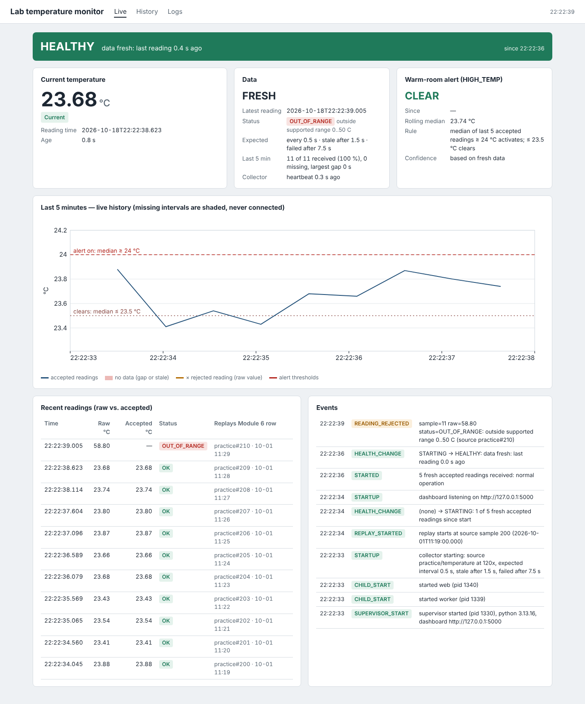

### 02_alert_active
Alert ACTIVE: rolling median of the last 5 accepted readings >= 24.0 C

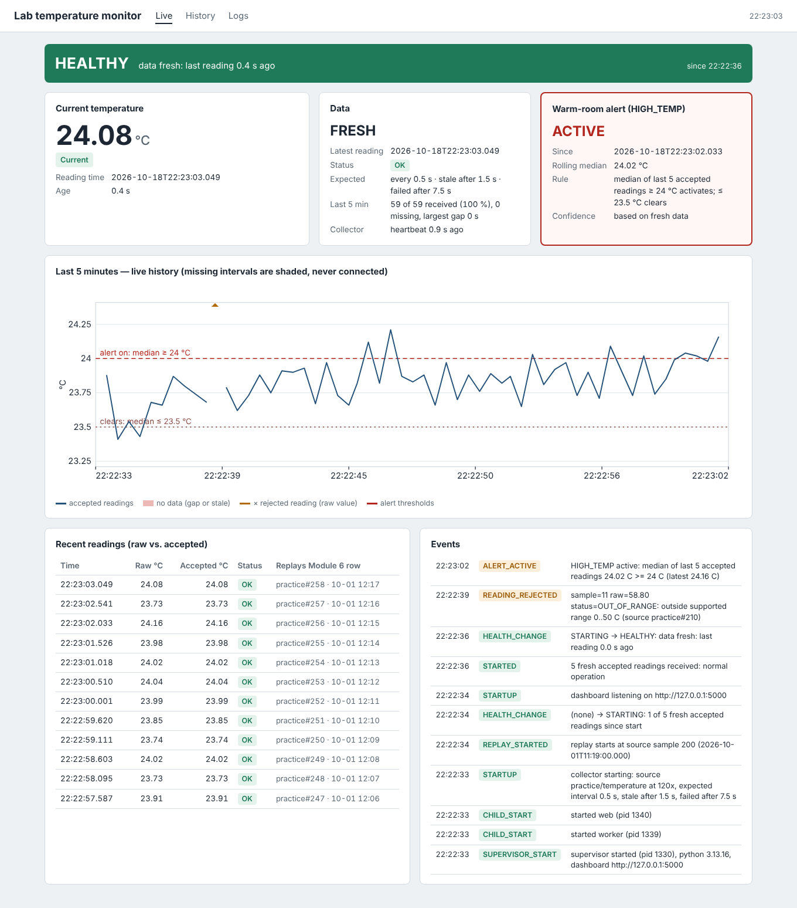

### 03_data_stale
Data STALE -> DEGRADED: value greyed out and marked 'not current'; the gap is shaded

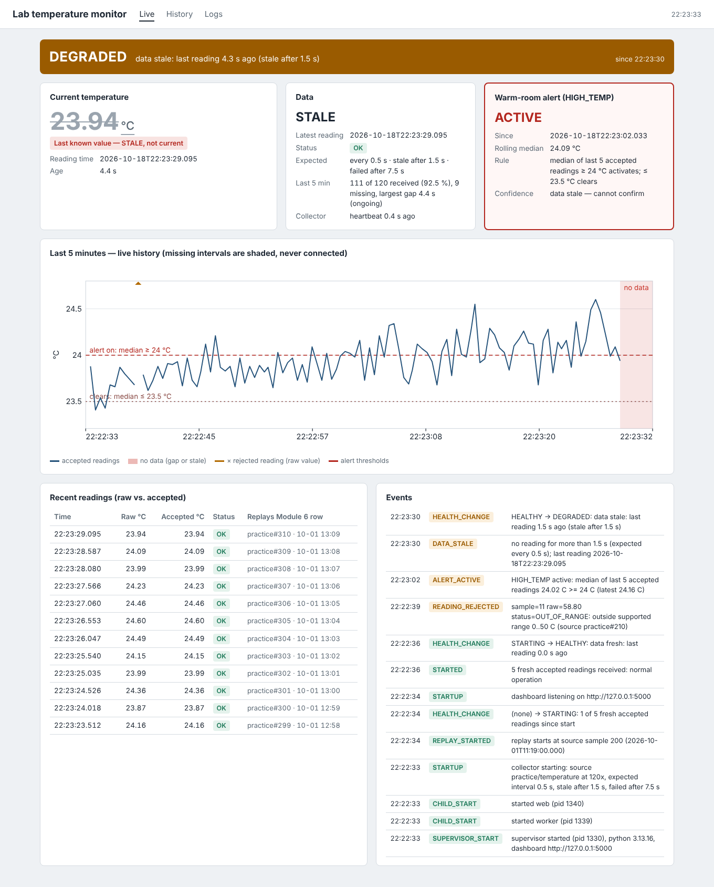

### 04_missing_data_failed
Expected data stopped arriving: FAILED; alert shown as 'data stale - cannot confirm'

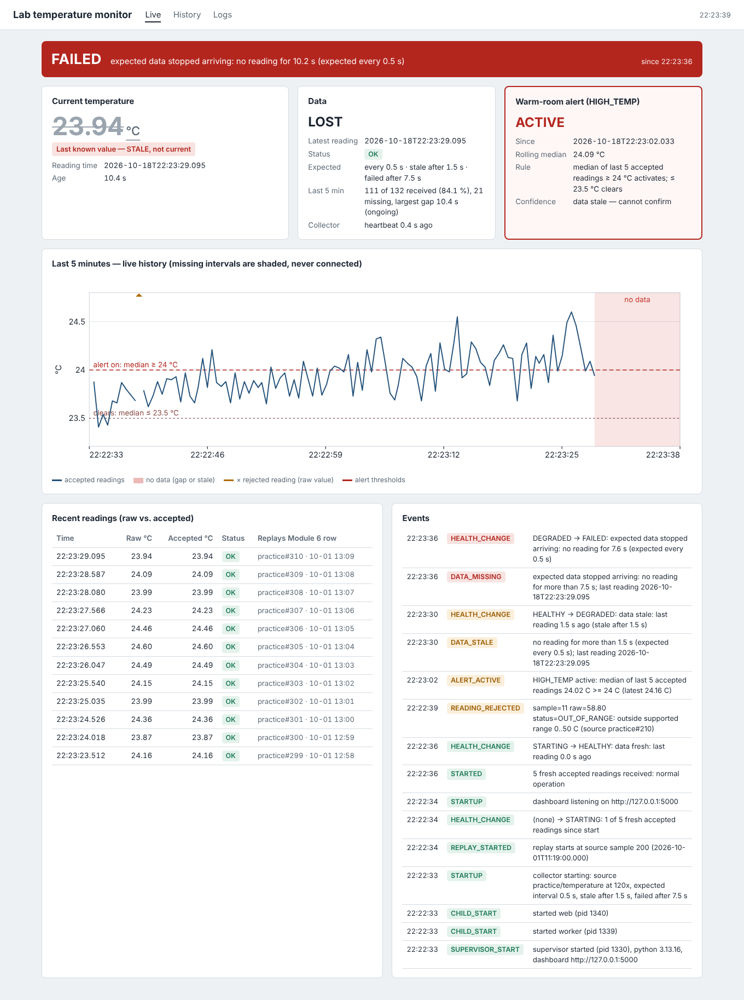

### 05_recovering_after_data_gap
Data resumed: RECOVERING until 5 fresh accepted readings; the gap stays shaded

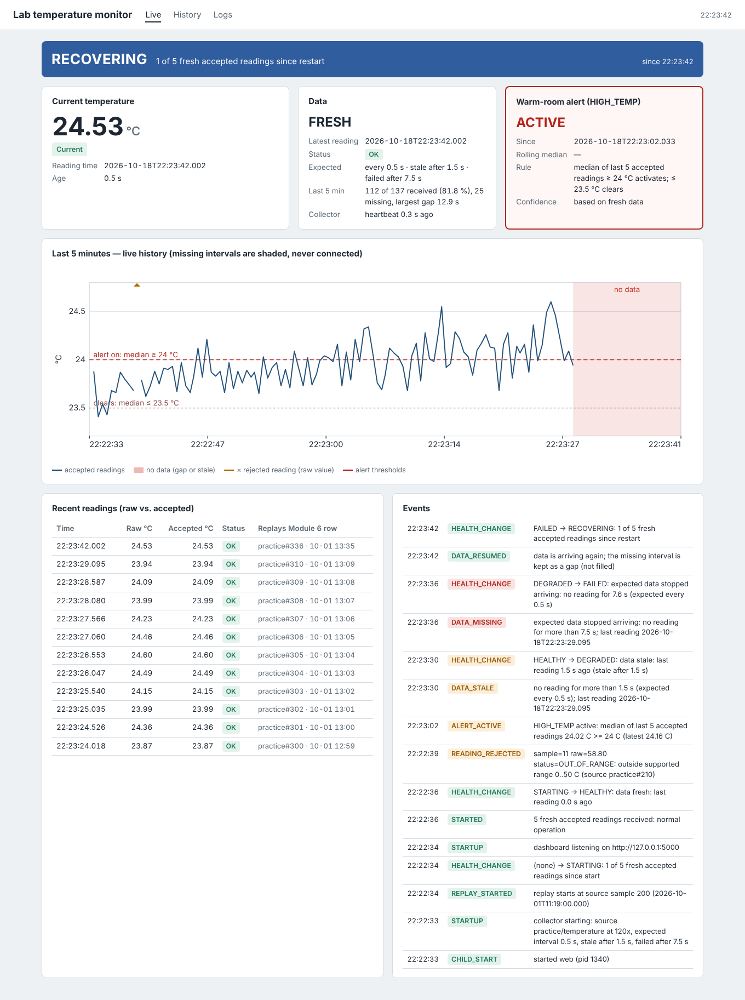

### 06_alert_cleared
Alert CLEARED: rolling median <= 23.5 C (hysteresis)

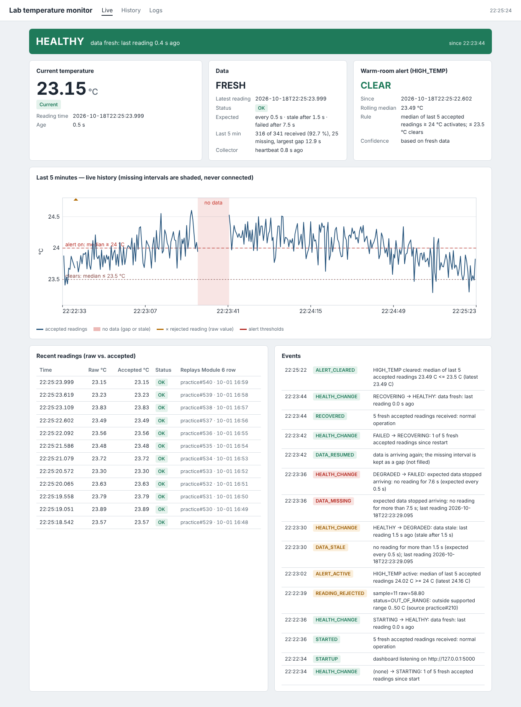

### 07_dashboard_unreachable_during_kill
Processes killed: the open page says the server is not responding and greys out the old values

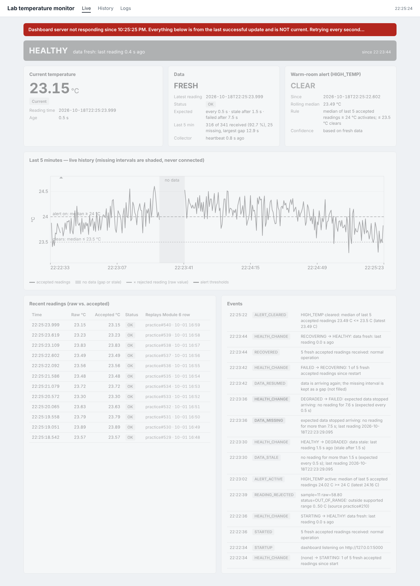

### 08_recovering_after_restart
Collector restarted after an unexpected stop: RECOVERING

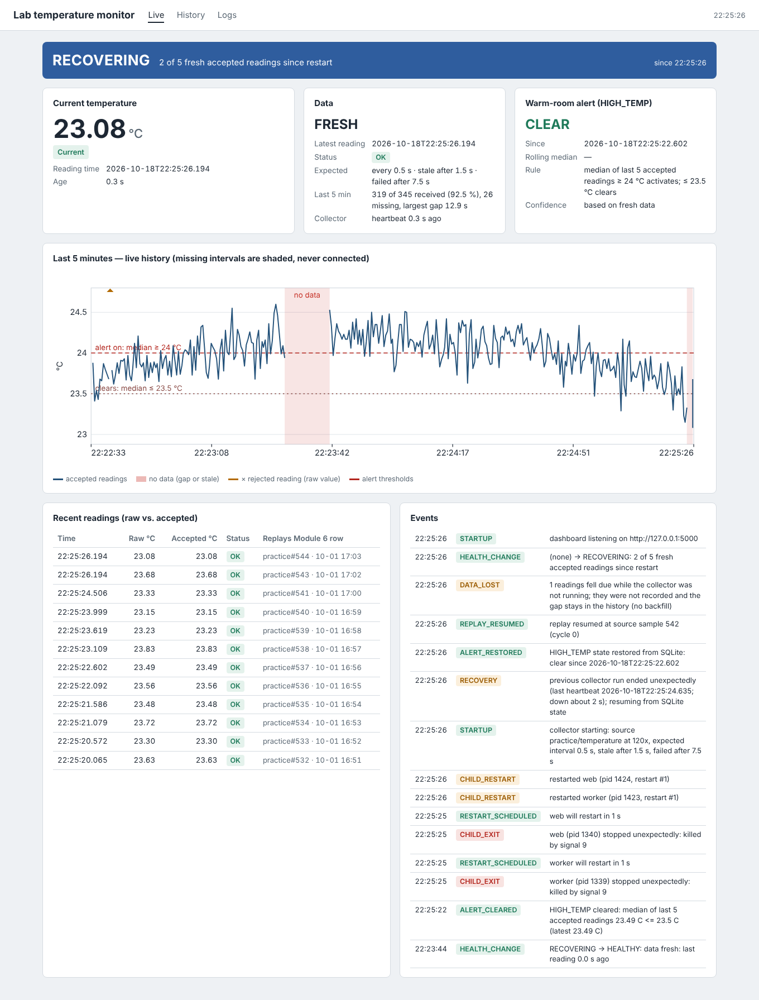

### 09_final_healthy
Final state after both recovery tests: HEALTHY

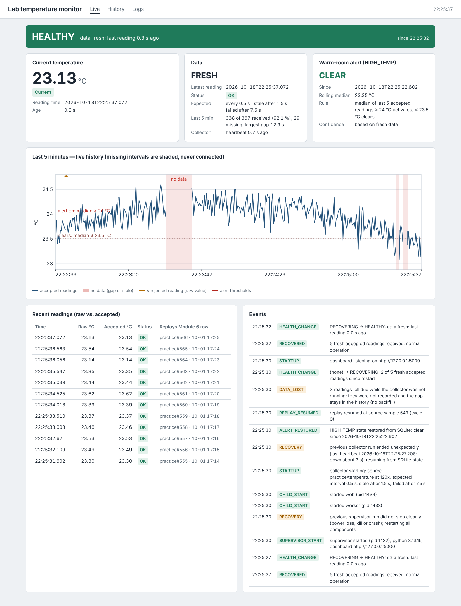

### 10_logs
Logs page: events table + tail of supervisor/worker/web logs

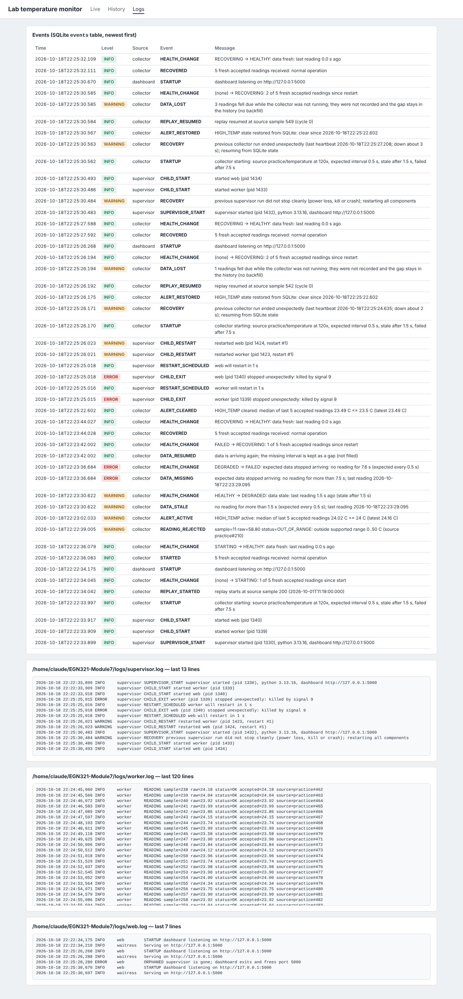

### 11_history_module6_last_day
Module 6 history (SQLite), last day, gaps preserved

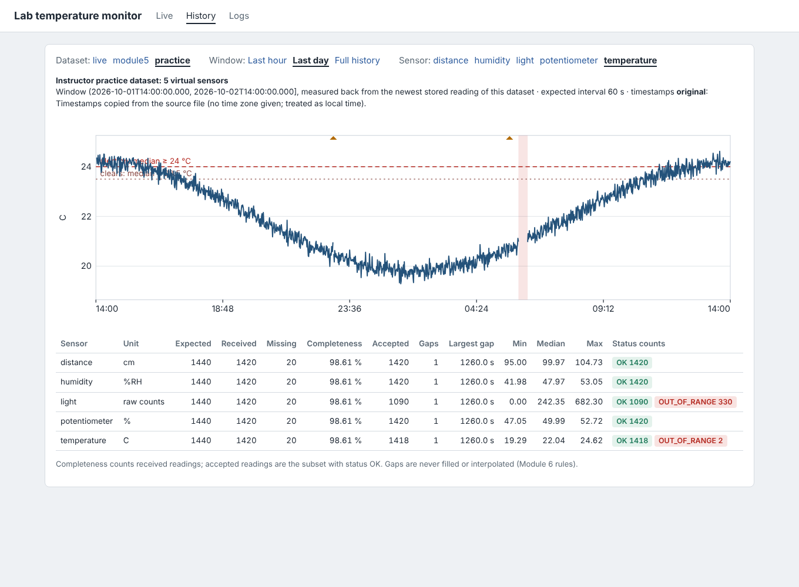

### 12_history_live_last_hour
Live history written by the collector, with the data gap and the outage gaps

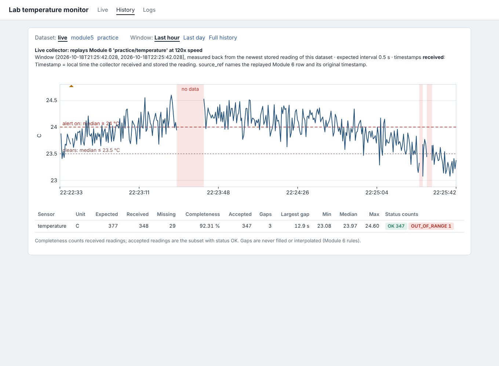

Full logs: `evidence/logs/`. Status polled every 0.2 s: `evidence/timeline.csv`. Database after the run:
`evidence/monitor_after_evidence_run.db`.

### 13_history_module6_full
Module 6 history (SQLite), full 30 h, both 25- and 20-minute gaps shaded and not connected; the 3 rejected spikes shown as off-scale markers

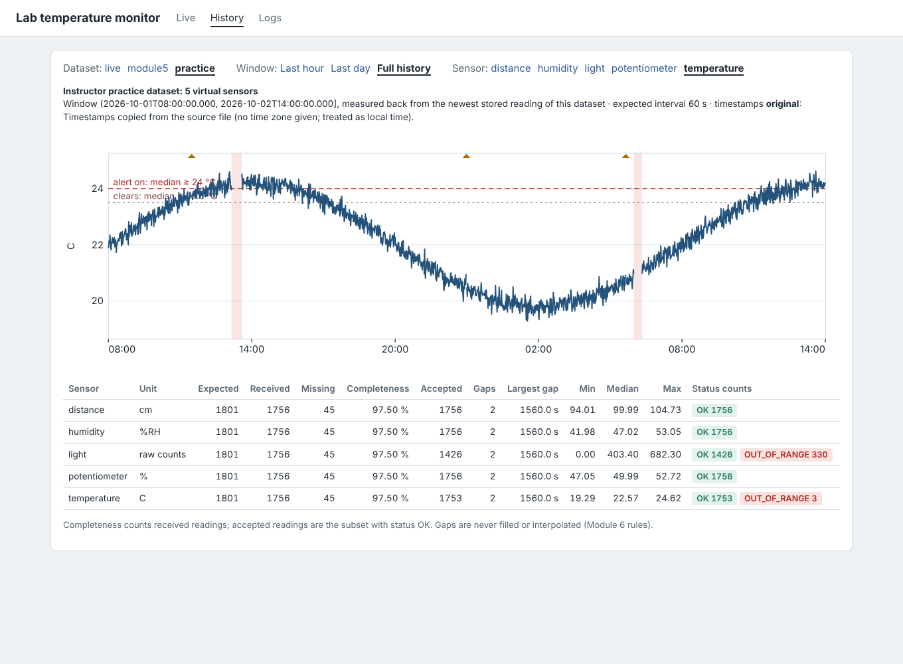
